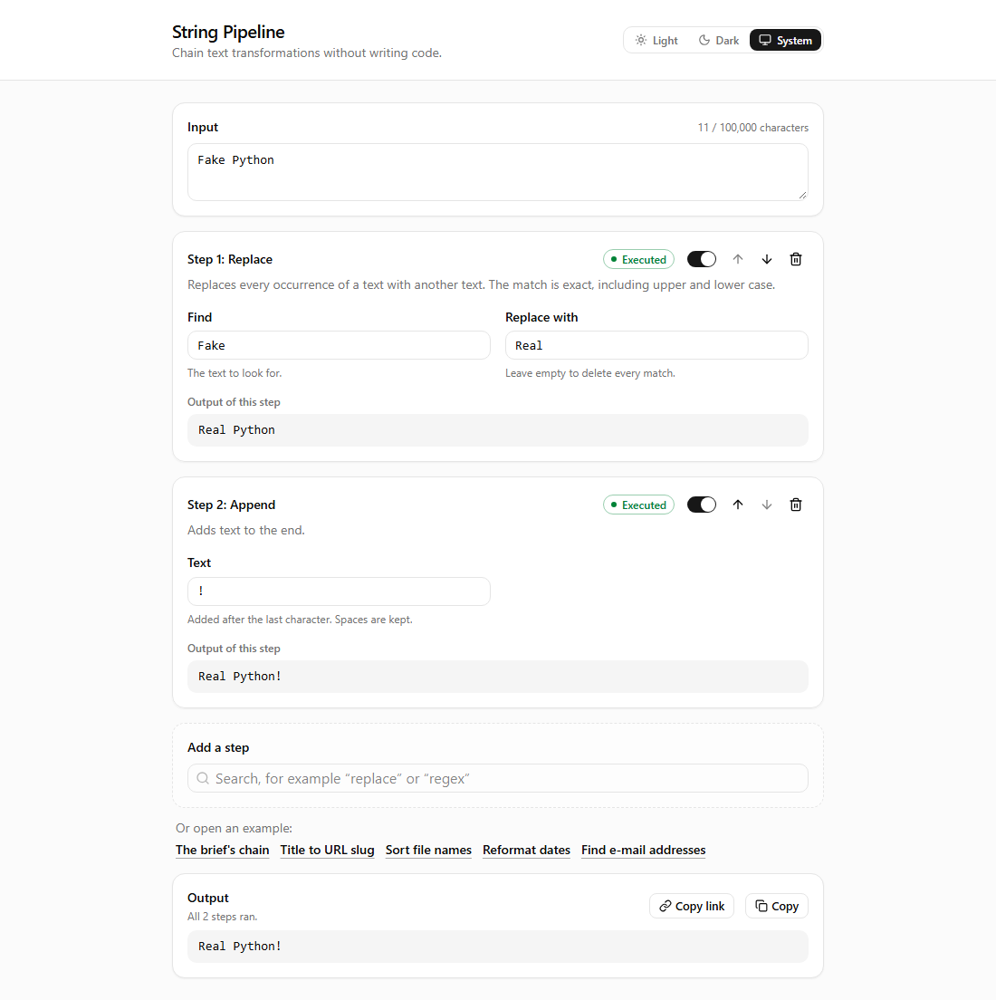

# String Pipeline

A no-code web app for chaining string transformations: pick transformations, configure each one in a form, see the result of every step. The frontend is Vue 3 with TypeScript; the transformations are a Java 25 library behind a Spring Boot web API. Built as a take-home assignment for the Full-Stack Software Engineer position at KNIME.



More screenshots: [a step with an error, at phone width](docs/images/editor-phone.png), [the dark theme](docs/images/editor-dark.png), [a Windows contrast theme](docs/images/editor-contrast.png), and [the editor in German](docs/images/editor-de.png).

## Prerequisites

- Docker with Compose, for the one-command start.
- Without Docker: any JDK 17+ to start Gradle. The modules compile with JDK 25: Gradle uses an installed JDK 25 or downloads one. Node.js 24.15+ with npm 11 for the frontend.

## Running the app

With Docker, one command builds and starts everything:

```sh
docker compose up --build
```

The app runs on http://localhost:8080, with Swagger UI at http://localhost:8080/swagger-ui.html. The first build takes a few minutes; `PORT=9090 docker compose up --build` uses another port (in PowerShell, set `$env:PORT = 9090` first). Type a text, add steps with the search field under the steps, or open one of the examples under it; every step shows its own output.

Without Docker, start the API, then the frontend in a second terminal:

```sh
./gradlew :server:bootRun
cd frontend && npm ci && npm run dev
```

The app then runs on http://localhost:5173, and Vite's dev server forwards `/api` to the API on port 8080.

## Documentation

- [Requirements](docs/requirements.md): the brief as numbered requirements, R1.1–R4.4
- [Decisions](docs/decisions.md): how we read the brief and why we chose what we chose, D1–D52
- [Design](docs/design.md): the API, the transformations, the library, the server and the frontend
- [API contract](contract/README.md): example requests and responses that the Java and TypeScript tests share
- [AI usage log](docs/ai-log/README.md): every step taken with the AI assistant, for people and for agents

The app was built step by step with Claude Code, running Claude Opus 5.5. The developer set the plan and reviewed every step before the next one began; commits the assistant helped write carry a `Co-Authored-By` trailer (R4.3).

## How it is built

| Path        | What                                                                                      |
| ----------- | ----------------------------------------------------------------------------------------- |
| `library/`  | Java 25 library with the transformations and the pipeline that chains them. No frameworks |
| `server/`   | Spring Boot 4 web API on top of the library                                               |
| `frontend/` | Vue 3 + TypeScript single-page app, built with Vite                                       |
| `contract/` | Example requests and responses that both the Java and the TypeScript tests read           |
| `buildSrc/` | Build conventions shared by the Java modules: JDK 25, compiler checks, formatting, JUnit  |

- **The library** gives every step a result: `Executed`, `NotConfigured`, `InvalidParameters`, `Failed` or `NotRun`. Problems are data, not exceptions, and every step's parameters are checked before any step runs, so a chain shows all its configuration problems at once. Texts are data too: a key and its values, which the caller renders in English, German or Russian. A transformation is one class that declares its parameters; `BuiltIns` lists the transformations and the example chains.
- **The web API** has two endpoints. The catalog describes each transformation's parameters as JSON Schema, and a run returns a result for every step. A malformed request gets Problem Details with JSON pointers to its fields. Both answer in the language that `Accept-Language` asks for. An ArchUnit test keeps the server on the library's public API.
- **The frontend** builds every form from the catalog and knows no transformation by name (R2.1). Pinia holds the chain, TanStack Query the server's answers, zod checks each answer at the boundary, vue-i18n holds the app's own texts, and SortableJS drags the steps. A component with behaviour is split into a model of pure functions, a controller, a view and a container. The UI kit is shadcn-vue on Reka UI.
- **Tests** cover every layer: 275 in Java, 256 Vitest tests in the frontend (unit, component, and integration against a stand-in API), and 30 end-to-end scenarios in Gherkin that run Chromium against the real API.

## Worth a look

- **R2.1, shown twice.** An integration test serves a catalog with a transformation the frontend has never seen, and checks that its form renders and runs. And the five harder transformations, from Change case to Reformat dates, were added later without a change to the frontend.
- **Text traps.** A character is what a person sees as one, so 👍🏽 is never cut in half. Turkish İ, ß, Windows line endings, 30 February and bytes that are not UTF-8 each have a test ([decisions](docs/decisions.md), Traps).
- **Limits.** A regular expression stops after 2 seconds, and no step may produce more than a million characters, so no chain can hang the server or exhaust its memory.
- **Accessibility.** After a step is added, moved or removed, the focus keeps the user's place. A live region tells screen readers how each run went, errors sit at their fields, and the focus, the step switches and the chosen theme stay visible in Windows contrast themes. For people who ask for less motion, nothing moves. The end-to-end tests run axe and walk every stop of the Tab key.
- **Messages as data.** The library never writes a sentence: it returns a key and its values, and whoever shows the message renders it. So the catalog, every step message and the request errors come in English, German or Russian from one `Accept-Language` header, and tests check that every language has every text, with the same values. Even Java's own regex and date-pattern errors are translated, each pinned by a test to Java's exact wording.
- **Strict checks.** Java compiles with Error Prone, NullAway and `-Werror`. TypeScript is strict and linted by oxlint and type-aware ESLint. Both sides check their formatting.

## Transformations

| Category            | Transformation  | What it does                                                                                               |
| ------------------- | --------------- | ---------------------------------------------------------------------------------------------------------- |
| Text                | Replace         | Replaces every occurrence of a text, exactly and case-sensitively                                          |
| Text                | Append, Prepend | Adds text to the end or to the beginning                                                                   |
| Text                | Substring       | Keeps part of the text like a Python slice, counting characters as you see them                            |
| Text                | Change case     | UPPER, lower or Title Case, or each line as camelCase, PascalCase, snake_case, kebab-case or CONSTANT_CASE |
| Lines               | Line operations | Sorts the lines with numbers by value, removes duplicate or blank lines, or reverses their order           |
| Conversions         | Encode, Decode  | Base64, URL-safe Base64, URL (percent-encoding) or hexadecimal, from and to UTF-8                          |
| Conversions         | Reformat dates  | Reads each line as a date in one pattern and writes it in another, strictly                                |
| Regular expressions | Regex extract   | Outputs the matches of a Java regular expression, one per line                                             |
| Regular expressions | Regex replace   | Replaces every match; the replacement can insert groups with `$1` or `${name}`                             |

Text rules:

- A character is what a person sees as one: 👍🏽, 🇩🇪 and an e with a combining accent are never split.
- Texts are never normalised, so é written in its two Unicode forms stays two different texts.
- Case changes follow no particular language unless a step picks Turkish or Azerbaijani, where i becomes İ and I becomes ı. Without a language, ß becomes SS, and İ becomes i followed by a combining dot.
- Line-based steps read `\n`, `\r\n` and `\r`, and write `\n`.
- Encode and Decode read and write text as UTF-8; month and day names in dates are English.

## Beyond the brief

Added after the brief was done, each in commits of its own ([decisions](docs/decisions.md), section J):

- A step can be turned off with the switch in its header. It keeps its place and its values, and the text passes through it unchanged (D48).
- The address holds the chain, so a link opens the same chain anywhere, and Copy link copies it. Edits change the address in place, and Back returns to the chain before a followed link (D49).
- Five example chains open with one click, under the search that adds steps. The server sends them with the catalog, the library's tests run each of them, and the frontend shows them as links (D50).
- Light, dark, or the system's theme, chosen in the header and kept for the next visit. A page in the dark theme does not flash white while it loads (D51).
- English, German or Russian, chosen in the header and kept for the next visit; a first visit follows the browser's languages. The app's own texts are in vue-i18n, the transformations' come from the server in the same language, and so do its messages (D52).
- The page uses the whole window: the steps in two columns, and the header and the search stay in place while the chain scrolls between them. A phone gets one column that scrolls as a whole, and the header keeps its layout in every language (D53).
- A step can be dragged by its handle to another place in the chain. The buttons still move it from the keyboard or with a single tap (D54).
- A run that fails, or a link that cannot be opened, pops up at the bottom right and goes away by itself. Several notices pile up, the newest in front, and spread out under the pointer (D55).

## Using the library

The library is plain Java 25 and runs without the web API ([design](docs/design.md), section 5):

```java
Catalog catalog = BuiltIns.catalog();
Step replace = new Step(
        catalog.find("replace").orElseThrow(),
        Map.of("old", ArgumentValue.text("Fake"), "new", ArgumentValue.text("Real")));
Step append = new Step(catalog.find("append").orElseThrow(), Map.of("text", ArgumentValue.text("!")));

PipelineResult result = new Pipeline(Limits.DEFAULT).run("Fake Python", List.of(replace, append));
result.output(); // Optional[Real Python!]
```

Every step's result is `Executed`, `NotConfigured`, `InvalidParameters`, `Failed` or `NotRun`: problems come back as data, never as exceptions. Their messages are data too, which `Messages.render(message, locale)` writes in English, German or Russian.

## Web API

| Endpoint           | What it does                                                                                    |
| ------------------ | ----------------------------------------------------------------------------------------------- |
| `GET /api/catalog` | Limits, categories, every transformation with its parameters as JSON Schema, and example chains |
| `POST /api/runs`   | Runs a chain and returns a result for every step                                                |

With the app running, in Docker or with `./gradlew :server:bootRun`, Swagger UI at http://localhost:8080/swagger-ui.html lets you try both endpoints. From the command line:

```sh
curl -H 'Content-Type: application/json' \
  --data-binary @contract/examples/brief-chain.request.json http://localhost:8080/api/runs
```

A problem inside a step comes back as that step's `status` with HTTP 200; a malformed request is a 400 with Problem Details (RFC 9457) and JSON pointers. Both endpoints answer in English, German or Russian, as `Accept-Language` asks, and in English without it. Every example request and response is in [contract/](contract/README.md).

## Commands

### Backend

From the repository root (`gradlew.bat` instead of `./gradlew` in cmd or PowerShell):

| Command                     | What it does                                                                   |
| --------------------------- | ------------------------------------------------------------------------------ |
| `./gradlew build`           | Compiles with Error Prone and NullAway, checks formatting, runs all tests      |
| `./gradlew :server:bootRun` | Starts the API on http://localhost:8080, with Swagger UI at `/swagger-ui.html` |
| `./gradlew spotlessApply`   | Formats the Java sources                                                       |

### Frontend

From `frontend/`, after `npm ci`:

| Command                           | What it does                                                                                                |
| --------------------------------- | ----------------------------------------------------------------------------------------------------------- |
| `npm run dev`                     | Starts the dev server on http://localhost:5173; it forwards `/api` to the API on port 8080                  |
| `npm run build`                   | Type-checks and builds the production bundle into `frontend/dist`                                           |
| `npm test`                        | Runs every Vitest suite: unit, component and integration; `npm run test:coverage` adds a V8 coverage report |
| `npm run test:unit`               | Runs only the unit tests: the model, the store, the API client, the queries and the controller              |
| `npm run test:e2e`                | Runs the Gherkin features in `e2e/` in Chromium against the real API and the built app (needs a JDK)        |
| `npm run screenshots`             | Takes the screenshots in `docs/images` from the real app, the same way as the end-to-end tests              |
| `npm run lint`                    | Runs oxlint, then ESLint for Vue templates, template accessibility and type-aware rules                     |
| `npm run typecheck`               | Type-checks the app, the tests and the config files with `vue-tsc`                                          |
| `npm run format`                  | Formats with Prettier; `npm run format:check` only checks                                                   |
| `npx shadcn-vue@2.8.2 add <name>` | Copies a shadcn-vue component into `src/components/ui/`, where it becomes our code (D28)                    |

The end-to-end tests start their own API (port 8091, through Gradle) and serve the built app with `vite preview` (port 4191), so servers on 8080 and 5173 keep running. To test an app that already runs, such as the Docker image, set its address: `E2E_BASE_URL=http://localhost:8080 npm run test:e2e`. Once per machine, they need Playwright's headless Chromium: `npx playwright install --only-shell chromium`.

### Before every commit

```sh
./gradlew build
cd frontend
npm run format:check && npm run lint && npm run typecheck && npm test && npm run build
npm run test:e2e
```

## Known issues

- The Docker image was built and tested on x86-64. Its base images and the npm lockfile cover ARM64 as well, as on a Mac with Apple Silicon, but that build was not tried.
- A link to a chain holds its input text (D49), so a long text makes a long link, which a chat app may cut off. The editor then says that it cannot open the link.
- Java writes its own messages in English only. The library translates the regex and date-pattern errors that people make while typing; a rarer one, and Java's reason why a line is not a date, stay English inside the translated sentence (D52).
- The AI log summarises the development session instead of exporting it, because the session also holds private correspondence (D25).
